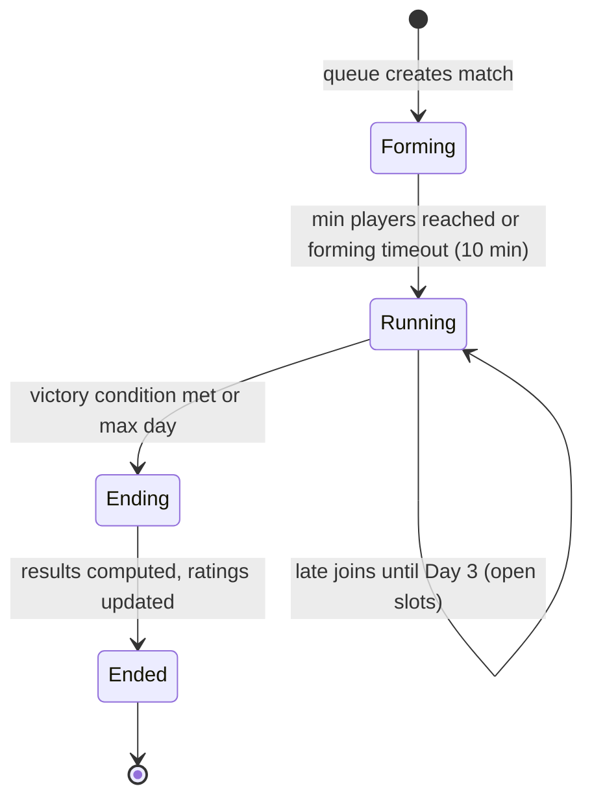

# Match lifecycle, modes, queues and victory

## 1. Lifecycle

| ID | Rule |
| --- | --- |
| GDD-MATCH-001 | Matches start when ≥ 50% of human slots are filled or after the forming timeout. Remaining slots are AI nations that humans can take over until **Day 3** (inheriting the AI's state). |
| GDD-MATCH-002 | A player may be in up to **3 active matches** (6 with Command Center). Convenience only. |
| GDD-MATCH-003 | Leaving a match is permanent; the nation becomes AI-controlled. |
| GDD-MATCH-004 | **Inactivity:** after 24 real hours without a check-in (12 h at 4x), the nation switches to AI caretaker mode (defensive). After 72 h it becomes fully AI, and the player is marked inactive for rating purposes. |

## 2. Launch maps

| Map ID | Players | Coalition size | Provinces | Region | Notes |
| --- | --- | --- | --- | --- | --- |
| `map.flashpoint_europe` | 16 | 2 | ~600 | Europe + Near East | First map; tutorial follow-up |
| `map.pacific_rim` | 32 | 3 | ~1,200 | Asia-Pacific | Naval-heavy |
| `map.americas` | 32 | 3 | ~1,100 | North + South America | |
| `map.world_conflict` | 64 | 4 | ~2,500 | World | Flagship |
| `map.world_overload` (post-launch) | 100 | 4 | ~3,000 | World | Event map |

## 3. Speed tiers

| Tier | 1 game day = | Typical length | Max match day |
| --- | --- | --- | --- |
| 1x | 24 h real | 3 to 4 weeks | 40 |
| 2x | 12 h real | 1.5 to 2 weeks | 40 |
| 4x | 6 h real | ~1 week | 40 |

## 4. Queues

| Queue | Rules | Rating |
| --- | --- | --- |
| `casual` | All maps and speeds. Logistics Boost may be enabled (ADR-0010, capped). | none |
| `ranked` | Linked account required; power-neutral; 32 and 64 maps; 1x and 2x | Glicko-2 per season |
| `coalition` (post-launch) | Pre-made coalitions queue together | team rating |
| `practice` | Solo vs AI, any map, can pause | none |
| `skirmish` (post-launch) | 8 players, 90 min, compressed rules | separate rating |

## 5. Victory

| ID | Rule |
| --- | --- |
| GDD-MATCH-010 | Each province and strategic site has VP. A **coalition** wins when its combined VP reaches the map's threshold (default 60% of total VP for 64-player maps; tunable per map). |
| GDD-MATCH-011 | Solo players (no coalition) win at a lower threshold (default 40%) to keep lone-wolf play viable. |
| GDD-MATCH-012 | At max match day, the highest-VP coalition wins. Ties are broken by total military strength destroyed. |
| GDD-MATCH-013 | Results screen: placement, VP over time graph, key battles, MVP stats, rating change, Campaign Pass XP. |
