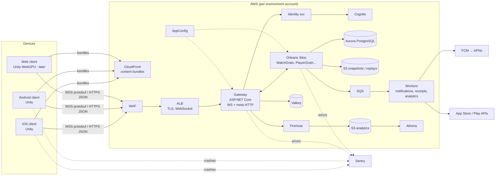
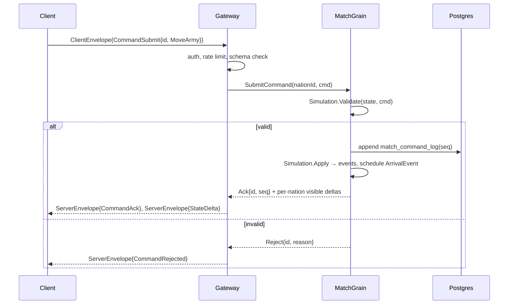

# Technical design overview

## System context

## Components

| Component | Responsibility | Doc |
| --- | --- | --- |
| Shared simulation | Deterministic game rules, used by server (authority) and client (preview) | [simulation](simulation.md) |
| Gateway | Terminates WebSockets, authenticates, routes commands to grains, fans out updates, meta HTTP API | [server runtime](server-runtime.md) |
| Silo | Hosts grains: matches, players, lobbies, queues, chat | [server runtime](server-runtime.md) |
| Workers | Async jobs: push notifications, receipt validation, analytics export, cleanup | [server runtime](server-runtime.md) |
| Identity | Guest credentials, Cognito token exchange, War Room session tokens | [identity](identity-and-accounts.md) |
| Protocol | Protobuf envelopes, sequencing, resync | [networking](networking-and-protocol.md) |
| Persistence | Postgres, command log, snapshots, Valkey | [data](data-and-persistence.md) |
| Client | Unity app: globe, HUD, state sync, platform services | [client architecture](client-architecture.md) |
| Globe renderer | Province-ID cubemap globe | [globe rendering](globe-rendering.md) |
| Geodata pipeline | Natural Earth → provinces, adjacency, map assets | [geodata pipeline](geodata-pipeline.md) |
| Infrastructure | AWS accounts, network, services, IaC | [infrastructure](infrastructure-aws.md) |
| Observability | Logs, metrics, traces, crashes, analytics | [observability](observability-and-analytics.md) |
| Security | Threat model, anti-cheat, data protection | [security](security-and-anti-cheat.md) |
| Scale | Capacity model, load tests, limits | [scalability](scalability-and-capacity.md) |

## Key flows

### Command flow (for example, "move army")

### Time progression

The `MatchGrain` keeps a priority queue of scheduled events keyed by `GameTime`. An Orleans timer (while active) or reminder (while idle) wakes the grain at the next event's real-time equivalent. The grain processes all due events in deterministic order, persists, and pushes deltas. Idle matches cost almost nothing (see [simulation](simulation.md#time-model)).

## Cross-cutting non-functional requirements

| ID | Requirement | Where addressed |
| --- | --- | --- |
| NFR-PERF-001 | 60/30 fps globe | [globe rendering](globe-rendering.md#performance-budgets) |
| NFR-PERF-002 | Command ack p95 ≤ 250 ms | [server runtime](server-runtime.md), [scalability](scalability-and-capacity.md) |
| NFR-SCALE-001 | 5k matches, 100k CCU | [scalability](scalability-and-capacity.md) |
| NFR-AVAIL-001 | 99.9%, RPO ≤ 1 min | [data](data-and-persistence.md) |
| NFR-SEC-001 | Server authority, no hidden-state leaks | [security](security-and-anti-cheat.md) |
| NFR-PRIV-001 | GDPR/CCPA, account deletion | [identity](identity-and-accounts.md), [security](security-and-anti-cheat.md) |
| NFR-OPS-001 | Machine-readable environments | [AI environment access](../06-environments/ai-environment-access.md) |
