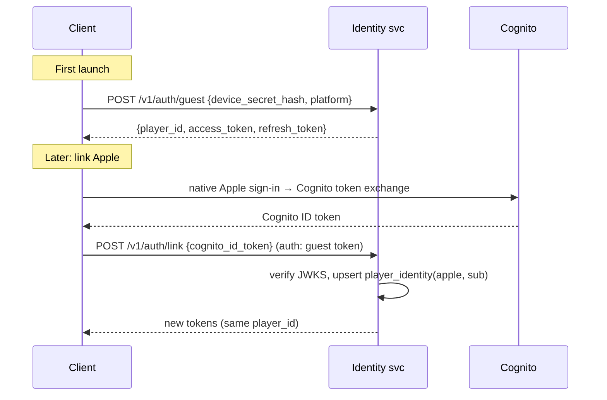

# Identity and accounts

## 1. Flows

## 2. Tokens

| Token | Format | Lifetime | Storage |
| --- | --- | --- | --- |
| Access | JWT ES256 (KMS key), claims: `sub` (player_id), `sid`, `ent` (entitlement hash), `env`, `ver` | 15 min | memory |
| Refresh | opaque 256-bit, rotating, family-tracked (reuse detection revokes the family) | 60 days sliding | Keychain / Keystore |
| Guest device secret | 256-bit random | until account deletion | Keychain / Keystore |

## 3. Rules

| ID | Rule |
| --- | --- |
| IDN-001 | `player_id` (UUIDv7) is permanent and never derived from an IdP subject. |
| IDN-002 | One IdP identity links to at most one player. Conflict flow: the user chooses which account to keep; the other is archived. |
| IDN-003 | Sign in with Apple must be offered on iOS whenever Google sign-in is offered. |
| IDN-004 | Account deletion: available in-app (Settings, Account, Delete). It revokes tokens immediately, queues erasure within 30 days, and anonymizes match history (nation shows "Former Commander"). |
| IDN-005 | Bans are enforced at token refresh and on WebSocket `Hello` (close code 4403). |
| IDN-006 | Display names are moderated (profanity filter plus report flow) and unique per discriminator (`Name#1234`). |
| IDN-007 | Age gate at first launch (year of birth). Under-13 users are not supported at launch (no COPPA flows); under-16 gets restricted chat in the EU (GDPR-K). |
