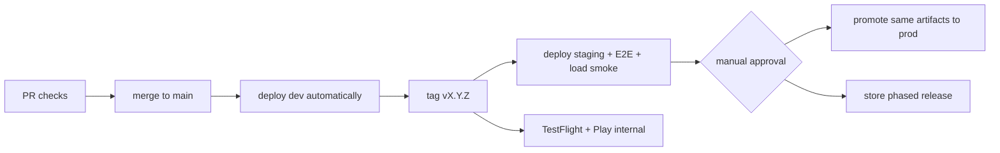

# Environments

Machine-readable versions of this table live in [`ops/environments/`](../../ops/environments/). **They are authoritative for endpoints and access.** This page explains the intent.

| Env | Purpose | Where | Data | Deploys | Agent policy |
| --- | --- | --- | --- | --- | --- |
| `local` | Developer machine: DevHost server, Postgres + Valkey in Docker, Unity Editor, emulators | owner's machine / cloud agent VM | synthetic | manual | full |
| `dev` | Shared cloud integration; device builds point here | `warroom-dev` (us-east-1) | synthetic, wiped freely | auto on `main` | read + deploy + apply Terraform |
| `staging` | Production-like; release candidates, load tests, closed playtests | `warroom-staging` | synthetic + playtest accounts | on release tag | read-only |
| `prod` | Live players | `warroom-prod` | real players (PII) | promoted artifact, manual approval | read-only (redacted) |

## Promotion flow

## Client builds per environment

| Build flavour | Points to | Distribution |
| --- | --- | --- |
| `Dev` | local or dev (switchable in debug menu) | Editor, direct install, TestFlight internal |
| `Staging` | staging | TestFlight external, Play closed testing |
| `Release` | prod | App Store, Google Play |

Environment selection is a build-time constant plus, in Dev builds only, a runtime override. Release builds cannot point at non-prod environments.

## Related docs

- [Local development](local-development.md)
- [Device testing (iOS, Android, emulators, device farms)](device-testing.md)
- [CI/CD](ci-cd.md)
- [AWS accounts and access](aws-accounts-and-access.md)
- [Secrets](secrets.md)
- [AI environment access](ai-environment-access.md)
