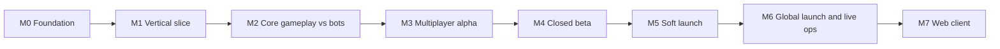

# Roadmap

Milestones are **capability gates**, not dates. A milestone is done when every exit criterion below is demonstrably true (CI green, evidence linked in the milestone issue). The machine-readable copy is [`backlog/milestones.yaml`](../../backlog/milestones.yaml); epics and stories declare the milestone they belong to.

## Ordering principles

1. **Risk first.** The riskiest technical bets (deterministic shared simulation, Orleans match runtime, mobile globe rendering at 60 fps) are proven in M1, before content volume.
2. **Always deployable.** From M1 onward `main` deploys to dev automatically; the game is always playable somewhere.
3. **Bots before humans.** Gameplay is tuned against AI nations (M2) before multiplayer infrastructure is scaled (M3), so a solo developer can playtest alone.
4. **Monetization late, fairness early.** Fair-by-design rules (ADR-0010) shape the economy from M2; the store itself lands in M4.
5. **Web is a port, not a rewrite.** Architecture keeps web viable (shared protocol, no native-only gameplay code); the web client itself is M7.

## Milestones

### M0 — Foundation

Goal: an AI agent can pick up any story and work on it without asking for context.

| Exit criterion | Evidence |
| --- | --- |
| Conventions, ADRs, GDD, TDD, UX docs exist and pass `make docs-check` | CI `repo-checks` |
| Backlog is schema-valid, indexed and synced to GitHub Projects | `make backlog-validate`, project board |
| Environment manifests exist for local/dev/staging/prod | `make ops-validate` |
| Repo hosted on GitHub with branch protection and required checks | repo settings |
| Store names reserved; trademark search started | EP-01 FE-01.4 |

Epics: EP-01, EP-02 (toolchain parts).

### M1 — Vertical slice

Goal: the riskiest end-to-end path works on a real phone.

| Exit criterion | Evidence |
| --- | --- |
| Globe renders the province map at 60 fps on iPhone and the reference Android emulator/device | perf capture |
| A guest player joins a dev match, orders one unit, and sees it move along a server-authoritative path | screen recording |
| Shared simulation passes golden replay tests on client and server builds | CI |
| Server deploys to the `dev` AWS account through CI with OIDC (no long-lived keys) | CI run |
| Agents can read dev logs, metrics and traces through MCP with `wr-agent-readonly` | session transcript |

Epics: EP-02, EP-03, EP-04, EP-05 (core), EP-06 (core), EP-07, EP-08 (guest), EP-09, EP-10 (first map), EP-11 (shell).

### M2 — Core gameplay vs bots

Goal: a complete single-player match against AI nations is fun at 4x speed.

| Exit criterion | Evidence |
| --- | --- |
| Economy, production, research, movement and combat implemented per GDD | GDD rule coverage report |
| AI nations play a full 16-player match without stalling | soak test |
| A 4x match completes end-to-end with a winner | replay |
| Check-in play works: push notifications for key events | device test |

Epics: EP-12, EP-13, EP-14, EP-16, EP-17, EP-19, EP-05/EP-06 remainder.

### M3 — Multiplayer alpha

Goal: friends can play real matches together.

| Exit criterion | Evidence |
| --- | --- |
| Lobbies, matchmaking and private matches work for 16 and 32 players | playtest |
| Diplomacy, coalitions and chat work, with basic moderation filters | playtest |
| Sign in with Apple and Google; guest upgrade keeps progress | device test |
| Staging environment exists and mirrors prod topology | `ops/environments/staging.yaml` status `active` |
| Telemetry pipeline answers retention and session questions in Athena | saved queries |

Epics: EP-08 remainder, EP-15, EP-18, EP-20, EP-23 (basics).

### M4 — Closed beta

Goal: production-shaped game with external testers through TestFlight and Play closed testing.

| Exit criterion | Evidence |
| --- | --- |
| 64-player map playable; load test at 2x target concurrency passes | load test report |
| Store (cosmetics, Campaign Pass, Command Center) works with server-side receipt validation | sandbox purchases |
| LiveOps: remote config, events and season rollover without a client release | AppConfig change |
| Moderation tools, reporting, account deletion, privacy labels complete | compliance checklist |
| Onboarding tutorial completes for 80% of new testers | funnel query |

Epics: EP-21, EP-22, EP-23, EP-24, EP-06/EP-18 scale work.

### M5 — Soft launch

Goal: validate retention and monetization in a few markets.

| Exit criterion | Evidence |
| --- | --- |
| Prod environment active; runbooks and on-call alerts in place | `ops/environments/prod.yaml` |
| Store listings approved in soft-launch markets | store consoles |
| KPI dashboards for KPI-01 to KPI-06 live | dashboard |
| Incident response and rollback drills completed | drill notes |

Epics: EP-25.

### M6 — Global launch and live ops

Goal: worldwide release and a sustainable season cadence.

Exit: soft-launch KPIs meet targets in [vision.md](../00-product/vision.md); season 2 content shipped as a content pack without a binary release.

### M7 — Web client

Goal: the same game in a browser, sharing accounts and matches.

Exit: a web player can join a match with mobile players; parity checklist complete. Epic: EP-26.

## Changing the roadmap

Changes to milestone scope go through a PR touching this doc and `backlog/milestones.yaml` together. Agents may propose changes but must not reorder milestones without the owner's approval (AGENTS.md hard rule: no invented product decisions).
